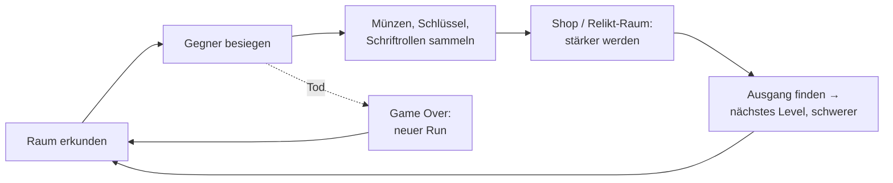

# Game Design Document – Relic Keep

> Aufgabe 15.10 · Informationstechnologie 6B · Godot 4.7

---

## 1. Titel & Pitch

**Titel:** Relic Keep

**Elevator Pitch:** Ein 2D-Pixel-Roguelike wie *Dead Cells*, in dem du dich durch zufällig gebaute Burg-Level kämpfst – und in seltenen Relikt-Räumen ein wertvolles Relikt gegen Gegnerwellen verteidigen musst, bevor es zerbricht.

**Die eigene Wendung (Twist):** Im Relikt-Raum zählt nicht nur dein eigenes Leben. Das Relikt hat eine eigene **Haltbarkeit**. Wenn die Gegner es zerstören, musst du die restlichen Wellen trotzdem überleben – bekommst aber keine Belohnung. Du musst also gleichzeitig angreifen und beschützen.

## 2. Genre, Plattform, Zielgruppe

- **Genre:** 2D-Action-Roguelike / Plattformer (Side-Scroller) mit Permadeath
- **Darstellung:** 2D-Pixel-Art, Auflösung 640 × 360, skaliert auf Vollbild
- **Plattform:** PC (Windows), später optional Web-Export für itch.io
- **Eingabe:** Tastatur oder Gamepad
- **Zielgruppe:** Jugendliche ab ca. 12 Jahren, die schnelle Action-Spiele mögen und gerne „noch einen Run“ spielen. Ein Run dauert ca. 10–20 Minuten, man kann also auch in einer Pause spielen.

## 3. Spielidee & Core Loop

Du startest jeden Run ganz unten in der Burg mit wenig Leben und ohne Relikte. Jedes Level wird zufällig aus Raum-Vorlagen zusammengesetzt. Du erkundest die Räume, besiegst Gegner, sammelst Münzen, Schlüssel und Upgrade-Schriftrollen und findest den Ausgang zum nächsten Level. Mit den Münzen kaufst du beim Händler Relikte, die dich stärker machen. Jedes dritte Level wartet ein Boss. Stirbst du, ist alles weg und du startest neu – aber mit mehr Erfahrung.

## 4. Steuerung

| Aktion | Tastatur | Gamepad |
|---|---|---|
| Laufen links / rechts | A / D (oder Pfeiltasten) | Linker Stick / Steuerkreuz |
| Springen | Leertaste | A |
| Durch Plattform fallen | S + Leertaste | Stick runter + A |
| Dash (Ausweichen) | Shift | B |
| Angreifen (Richtung mit A/D/W/S) | J oder linke Maustaste | X |
| Ground Slam (aus der Luft) | S antippen (in mind. 4,5 Tiles Höhe) | Stick runter |
| Interagieren (Shop, Tür, Relikt) | E | Y |
| Karte | M oder Tab | Back |
| Pause / Inventar | Esc | Start |
| Vollbild umschalten | F11 | – |

## 5. Regeln, Sieg und Niederlage

- Der Spieler startet mit **100 Lebenspunkten** und hat **nur ein Leben** (Permadeath).
- Gegner richten Schaden an; Heilung gibt es nur zu Beginn einer Boss-Stage und durch Relikte.
- Ein Level ist geschafft, wenn man den **Level-Ausgang** erreicht; bei Boss-Stages öffnet sich der Ausgang erst, wenn der Boss tot ist.
- Man kann **maximal 3 Relikte** ausrüsten plus **1 Rucksack-Slot** (gibt keine Werte, nur Aufbewahrung).
- **Sieg:** Den zweiten Boss (*Keeper of Relics*, Level 6) besiegen und die Burg verlassen.
- **Niederlage:** Lebenspunkte auf 0 → Game Over. Münzen, Schlüssel, Relikte und Upgrades gehen verloren.

## 6. Gegner und Herausforderungen

| Gegner | Verhalten |
|---|---|
| **Walker** | Patrouilliert hin und her. Sieht er dich (nah und mit Sichtlinie), läuft er auf dich zu und schlägt zu. |
| **Archer** | Hält Abstand und schießt Pfeile auf dich. Pfeile werden von Wänden gestoppt. |
| **Flyer** | Fliegt durch die Luft und ignoriert Plattformen; stürzt sich auf dich herab. |
| **Brute** (ab Level 2) | Langsam, viel Leben, harter Schlag mit langer Ausholbewegung – man muss ausweichen. |
| **Warden** (Mini-Boss) | Wartet in einer Arena, deren Türen sich schließen. Greift mit Schlag und Sturmangriff an. |
| **Keeper of Relics** (Boss) | Schlag, Sturmangriff, Ground Slam mit Schockwellen, Pfeilsalve; ruft in Phase 2 Gegner herbei. |

**Weitere Herausforderungen:**
- **Relikt-Verteidigung:** Gegnerwellen greifen ein Relikt an; es hat eine eigene Haltbarkeitsleiste.
- **Verschlossene Schatzräume:** brauchen einen Schlüssel oder Münzen. Der Schlüssel wird im Level von zwei starken Wächtern bewacht.
- **Verwinkelte Level:** kleine, verschachtelte Räume, man braucht die Karte zur Orientierung.

## 7. Fortschritt & Schwierigkeit

- Jedes Level ist **zufällig generiert** (ca. 30 Räume) und etwas schwerer als das vorige.
- **Mehr und stärkere Gegner** pro Level; Brutes erscheinen ab Level 2.
- **Jedes 3. Level** ist eine Boss-Stage: kurzer Weg → Shop → Boss-Arena.
- Pro Level gibt es **1 Mini-Boss**, **1 Shop** und **2–3 Upgrade-Schriftrollen** (+HP, +Schaden, +Angriffstempo, +Krit, +Rüstung, +Tempo).
- Der Spieler wird durch Relikte und Upgrades stärker; das Spiel muss so abgestimmt sein, dass man ohne Upgrades trotzdem kaum durchkommt.

## 8. Benutzeroberfläche

Alle Bildschirme (Skizzen in `docs/img/`):

| Bildschirm | Inhalt | Skizze |
|---|---|---|
| Hauptmenü | Logo, Spielen, Einstellungen, Beenden |  |
| HUD | Lebensbalken, Münzen/Schlüssel, 3 Relikt-Slots + Rucksack, Minikarte, Boss-Leiste |  |
| Pausemenü (Esc) | Weiter, Einstellungen, Hauptmenü + Inventar und Upgrades |  |
| Karte (M/Tab) | Bereits besuchte Räume, farbige Spezialräume |  |
| Game Over | Erreichtes Level, besiegte Gegner, Neuer Run / Hauptmenü |  |
| Einstellungen | Lautstärke Musik/Effekte, Vollbild, Steuerung |  |

## 9. Visueller Stil & Audio

**Stimmung:** Dunkle, alte Burg bei Nacht – unheimlich, aber nicht brutal. Fackeln und goldene Münzen setzen warme Lichtpunkte in kalte Steinräume. Kampf soll sich schnell und „knackig“ anfühlen (kurzes Bildschirmwackeln, Treffer-Blitz).

**Moodboard (Referenzen):**
1. [Dead Cells](https://store.steampowered.com/app/588650/Dead_Cells/) – Spielgefühl, Raumaufbau, Kampf-Tempo
2. [Hollow Knight](https://store.steampowered.com/app/367520/Hollow_Knight/) – dunkle Atmosphäre, Karte, Gegnerdesign
3. [Blasphemous](https://store.steampowered.com/app/774361/Blasphemous/) – düstere Pixel-Art, Burg/Kathedrale
4. [Kenney – Pixel Platformer](https://kenney.nl/assets/pixel-platformer) – Platzhalter-Tiles und Sprites
5. [Kenney – Tiny Dungeon](https://kenney.nl/assets/tiny-dungeon) – Gegner, Items, Truhen

**Farbpalette:**

| Farbe | Hex | Verwendung |
|---|---|---|
| Nachtblau | `#1B1B2F` | Hintergrund |
| Burgstein | `#3E2C41` | Wände, Plattformen |
| Gold | `#C9A227` | Münzen, UI-Rahmen, verschlossene Räume |
| Relikt-Lila | `#7B3FA0` | Relikte, Relikt-Räume |
| Blutrot | `#B23A48` | Lebensbalken, Boss |
| Moosgrün | `#4CAF50` | Shop |
| Pergament | `#E8E1CF` | Schrift |

**Audio:** Musik im Stil **„düster-ambient mit Retro-Chiptune“** – ruhige Orgel-/Synth-Flächen beim Erkunden, schnellere Drums im Bosskampf. Soundeffekte im 8-Bit-Stil: Schwert-Swoosh, Treffer, Münz-Klimpern, Sprung, Dash, Tür. Quellen: Kenney-Audio-Packs bzw. selbst erstellt mit jsfxr.

## 10. Umfang & Zeitplan

### MoSCoW

**Must (ohne geht es nicht)**
- Spieler: Laufen, Springen, Dash, Angriff, Lebenspunkte
- 3 Gegnertypen (Walker, Archer, Flyer)
- Zufälliger Level-Generator aus Raum-Vorlagen + Level-Ausgang
- HUD (Leben, Münzen), Hauptmenü, Game Over
- Permadeath / neuer Run

**Should (wichtig)**
- Relikt-Verteidigungsraum mit Haltbarkeit (der Twist!)
- Shop mit Relikten, Münzen und Schlüssel
- 1 Boss (Keeper of Relics), Mini-Boss Warden
- Pausemenü mit Inventar, Karte
- Musik und Soundeffekte

**Could (wenn Zeit bleibt)**
- Upgrade-Schriftrollen, Rucksack-Slot
- Waffen zum Wechseln
- Einstellungen (Lautstärke), Gamepad-Feinschliff
- Eigene Pixel-Art statt Kenney-Platzhalter, Partikel-Effekte

**Won't (bewusst weglassen)**
- Online-Multiplayer
- Speichern mitten im Run
- Story mit Zwischensequenzen
- Mehrere Welten / Biome

### Zeitplan (ca. 20 Unterrichtseinheiten)

| Aufgabe | Inhalt | UE |
|---|---|---|
| 15.11 | Spieler-Steuerung, Kampf (Hitbox/Hurtbox), Testlevel | 3 |
| 15.12 | Gegner Walker/Archer/Flyer + Brute, Loot | 3 |
| 15.13 | Level-Generator, Raum-Vorlagen, Karte | 3 |
| 15.14 | HUD, Hauptmenü, Pausemenü, Game Over | 3 |
| 15.15 | Relikt-Raum, Shop, Mini-Boss/Boss | 3 |
| 15.16 | Sound, Musik, Grafik-Stil, Effekte | 2 |
| 15.17 | Bugs beheben, Balancing, Export & Veröffentlichung | 3 |

---

## Risiken

| Risiko | Plan B |
|---|---|
| Level-Generator erzeugt unschaffbare Räume (Sprünge zu hoch, verbaute Ausgänge) | Feste Regeln für Vorlagen (max. 3 Tiles hohe Plattformen, 4 Tiles breite Ausgänge) + automatischer Test; notfalls feste, handgebaute Level |
| Boss ist zu aufwendig | Boss mit nur 2 Angriffen, Phase 2 streichen |
| Eigene Pixel-Art dauert zu lange | Kenney-Assets als Grafik verwenden |
| Spiel läuft auf den Schul-PCs (Intel UHD 630) zu langsam | Compatibility-Renderer, weniger Partikel, weniger Gegner pro Raum |
| Balancing (zu schwer/zu leicht) | Werte als `@export` im Inspector, damit man sie schnell anpassen kann; Mitschüler testen lassen |
| Zeit reicht nicht | Nur die Must-Liste fertig machen, Should/Could streichen |

## Technik

- **Engine:** Godot 4.7 (GDScript), Renderer: Compatibility
- **Auflösung:** 640 × 360, Stretch Mode `canvas_items`, Vollbild
- **Versionsverwaltung:** Git + GitHub Desktop
- **Ordnerstruktur:** `mein_spiel/` mit `docs/`, `scenes/`, `scripts/`, `assets/{models,textures,audio,fonts}`
